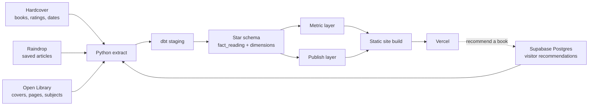

# Reading Library

A personal reading data pipeline. Books from Hardcover, articles from Raindrop and book recommendations from visitors are extracted nightly, modelled in a dbt star schema on DuckDB, tested, and published as a static site with a metric layer behind every number.

**Live site:** https://reading-room-shelf.vercel.app
**dbt docs (models, lineage, tests):** https://reading-room-shelf.vercel.app/docs/
**Write-up:** [docs/case-study.md](docs/case-study.md)

## Why I built it

My reading lives in a tracker app that logs books well but answers simple questions badly: how many books did I read this year, how fast do I read, what do I rate highest. Some books have no finish date, some are re-reads, and the articles I read live in another app entirely. Two charts built separately would disagree.

I wanted one place for everything I read, where every number is defined once and tested, refreshed without any manual step, and safe to make public. It is also a portfolio project for data and BI engineering, since my other pipeline runs on private data and cannot be shown.

## Architecture



One GitHub Actions workflow ([`nightly.yml`](.github/workflows/nightly.yml)) runs every night at 03:00 UTC and on every push to `main`:

1. ruff and pytest
2. `python -m extract`: pull from all four sources into `data/raw/`
3. `dbt build`: models plus data and unit tests, then source freshness and dbt docs
4. node tests, then the static site build
5. deploy to Vercel, only if every step passed

Raw extracts are never committed. The last extract that passed all tests is kept in the Actions cache and used as the fallback when Raindrop or Supabase is unavailable. If Hardcover fails or returns nothing, the run stops and the live site keeps yesterday's data.

## Stack

| Layer | Tool |
|---|---|
| Extract | Python 3.12, `requests` |
| Warehouse | DuckDB (single file) |
| Modelling and tests | dbt-core 1.9 with dbt-duckdb |
| App database | Supabase (Postgres, row-level security) |
| Orchestration | GitHub Actions (cron and push) |
| Site | Observable Framework, Observable Plot, three.js |
| Hosting | Vercel |

## Data model

Layers: `staging` (6 models) → `marts` (11) → `metrics` (19) and `publish` (5). The site reads only the `metrics` and `publish` schemas.

**Fact grain:** one row per finished read of one item. A re-read is two rows; a book on the want-to-read shelf is not a row; an article counts once, on the day it was saved.

| Model | Role |
|---|---|
| `fact_reading` | reading_id, item_id, date_id (nullable), rating (0 to 10), reading_minutes (1.5 min per page) |
| `dim_item` | books and articles in one dimension, split by `item_type` |
| `dim_creator`, `bridge_item_creator` | authors, many-to-many |
| `dim_topic`, `bridge_item_topic` | Open Library subjects, generic tags flagged |
| `bridge_item_mood` | moods other readers tagged on Hardcover |
| `dim_source`, `dim_date` | publishers and publications; calendar |

Genres are assigned by rules in [`dbt/seeds/genre_rules.csv`](dbt/seeds/genre_rules.csv) over Open Library subjects, Hardcover tags and the title, then the author's usual genre, then Fiction.

### Metric layer

Each metric is one dbt model, so a number is defined in exactly one place: items read, books and reads per period, pages, reading time, reading pace, reading spells, average rating (by type, genre, topic, creator), rating spread, top authors, genre mix, fiction split, moods, page-length bands, publication years, article sources, topic mix, undated reads.

**Reading pace** is measured inside reading spells. A gap of more than 180 days between books (`reading_break_days` in [`dbt_project.yml`](dbt/dbt_project.yml)) ends a spell, so long breaks do not distort the pace. Over the whole history it is one book every 105 days; while reading it is one every 39.

### Recommendations: app database to warehouse

Visitors search Open Library on the site and send a book, with an optional name and note. The page inserts the row into Supabase with the public anon key; row-level security makes the table insert-only ([`supabase/recommendations.sql`](supabase/recommendations.sql)). The nightly extract reads it with the service key and keeps only books that resolve to a real Open Library work, using Open Library's title, author and cover rather than the visitor's text. Names or notes containing a link are dropped. dbt folds repeat recommendations into one row per book. Recommendations stay out of `fact_reading`, since they are books I have not read.

## Data quality

- **54 data tests** across 45 models: unique and not-null keys, accepted values, relationships.
- **16 unit tests** for the edge cases: re-reads, undated reads, abandoned books, unmatched books, articles entering the model, repeat recommendations, shelf order, reading-spell boundaries.
- **Consistency test** ([`assert_metrics_agree.sql`](dbt/tests/assert_metrics_agree.sql)): dated plus undated reads equal total reads, and totals agree across metrics.
- **Privacy test** ([`assert_published_columns_allowed.sql`](dbt/tests/assert_published_columns_allowed.sql)): every column in the published schemas must be on an allow-list.
- **Source freshness:** warns when an extract is older than 36 hours.
- **pytest** for the extractors with mocked APIs; node tests for the site's helpers.

## Getting started

Requirements: Python 3.12, Node 20.

```bash
python -m venv .venv
.venv/Scripts/pip install -r requirements-dev.txt     # macOS/Linux: .venv/bin/pip
cp .env.example .env                                    # add your tokens

.venv/Scripts/python -m extract                        # needs HARDCOVER_API_TOKEN
cd dbt && ../.venv/Scripts/dbt build --profiles-dir . && cd ..

cd site && npm ci
PYTHON=../.venv/Scripts/python npx observable preview  # http://127.0.0.1:3000
```

| Command | What it does |
|---|---|
| `ruff check .` | lint the Python |
| `pytest -q` | extractor tests |
| `dbt build --profiles-dir .` (in `dbt/`) | build models and run all dbt tests |
| `npm test` (in `site/`) | site helper tests |
| `npm run build` (in `site/`) | build the static site into `site/dist/` |

### Configuration

| Name | Kind | Needed for |
|---|---|---|
| `HARDCOVER_API_TOKEN` | secret | books (required) |
| `RAINDROP_TOKEN` | secret | articles (optional) |
| `SUPABASE_SERVICE_KEY` | secret | reading recommendations (optional) |
| `SUPABASE_URL`, `SUPABASE_ANON_KEY` | variable | the recommend form (optional) |
| `VERCEL_TOKEN` | secret | deploy |
| `VERCEL_ORG_ID`, `VERCEL_PROJECT_ID` | variable | deploy |

Locally these go in `.env`; in CI they are repository secrets and variables. Without the optional ones the pipeline still runs and those sources are skipped.

## Project structure

```
extract/            extractors: Hardcover, Open Library, Raindrop, Supabase
dbt/                staging, marts, metrics and publish models; seeds; tests
site/src/           pages, components, data loaders, 3D models
supabase/           recommendations table and access rules
scripts/            dbt docs copy, glTF packer
tests/              pytest for the extractors
docs/case-study.md  problem, approach, decisions, results
```

## The site

The home page shows the books and articles as a 3D bookcase, with recommendations in a second compartment and a search across both. A Stats page draws each metric with Observable Plot, with the numbers in a table under every chart.

## Limitations

- Articles are dated by when they were saved, not read, so they are kept out of the time-based charts.
- A few books (4 of 38) have no finish date; they count in totals but not in any month or year.
- Pull requests build without data (no secrets), so they run lint, unit tests and `dbt parse` only; the full data build runs on `main`.
- Supabase free projects pause after a week of inactivity; the nightly read is expected to keep it active.

## Credits

Book data from [Hardcover](https://hardcover.app) and [Open Library](https://openlibrary.org). 3D shelf objects from [Poly Haven](https://polyhaven.com) (CC0).
