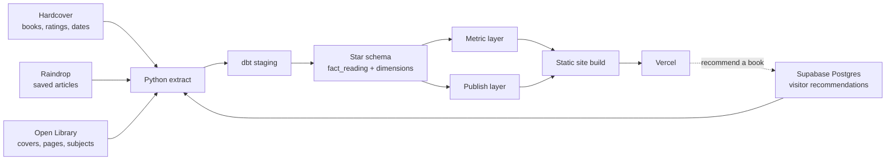
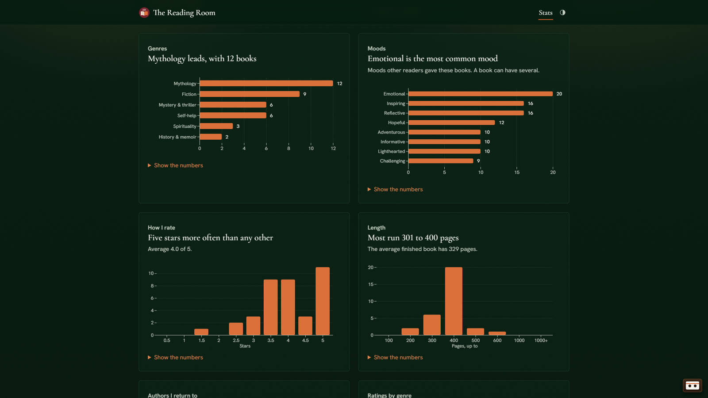
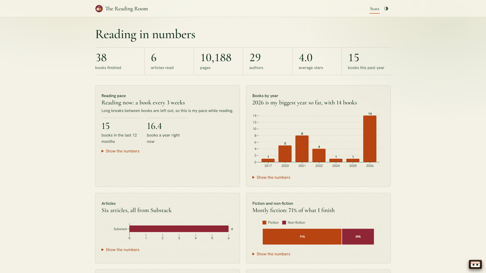

<div align="center">


# Reading Library

A personal reading data pipeline: books, articles and visitor recommendations, modelled in dbt on DuckDB, tested, and published weekly as a 3D bookcase.

[](https://github.com/surbhi-bhor/reading-library/actions/workflows/weekly.yml)


**[Live site](https://reading-room-shelf.vercel.app)** · **[dbt docs](https://reading-room-shelf.vercel.app/docs)** · **[Case study](docs/case-study.md)**

<a href="docs/demo.mp4"></a>


https://github.com/user-attachments/assets/0244222d-c06a-4a71-8a27-6a47450f780e


</div>

## Why I built it

I track my books on Hardcover, which has great stats of its own, and save articles in Raindrop. I wanted everything I read in one place and more control over my stats: every number defined once and tested, refreshed without any manual step, and safe to make public.

## Architecture



One GitHub Actions workflow ([`weekly.yml`](.github/workflows/weekly.yml)) runs every Friday at 00:00 UTC and on every push to `main`:

1. ruff and pytest
2. `python -m extract`: pull from all four sources into `data/raw/`
3. `dbt build`: models plus data and unit tests, then source freshness and dbt docs
4. node tests, then the static site build
5. deploy to Vercel, only if every step passed

Raw extracts are never committed. The last extract that passed all tests is kept in the Actions cache and used as the fallback when Raindrop or Supabase is unavailable. If Hardcover fails or returns nothing, the run stops and the live site keeps the previous run's data.

A second small workflow ([`keepalive.yml`](.github/workflows/keepalive.yml)) reads one row from Supabase every Tuesday, so the free project never reaches its 7-day inactivity pause between weekly runs.

## Stack

| Layer | Tool |
|---|---|
| Extract | Python 3.12, `requests` |
| Warehouse | DuckDB (single file) |
| Modelling and tests | dbt-core 1.9 with dbt-duckdb |
| App database | Supabase (Postgres, row-level security) |
| Orchestration | GitHub Actions (cron and push) |
| Site | Observable Framework, Observable Plot, three.js |
| Hosting | Vercel |

## Data model

Layers: `staging` (6 models) → `marts` (11) → `metrics` (18) and `publish` (5). The site reads only the `metrics` and `publish` schemas.

**Fact grain:** one row per finished read of one item. A re-read is two rows; a book on the want-to-read shelf is not a row; an article counts once, on the day it was saved.

| Model | Role |
|---|---|
| `fact_reading` | reading_id, item_id, date_id (nullable), rating (0 to 10), reading_minutes (1.5 min per page) |
| `dim_item` | books and articles in one dimension, split by `item_type` |
| `dim_creator`, `bridge_item_creator` | authors, many-to-many |
| `dim_topic`, `bridge_item_topic` | Open Library subjects, generic tags flagged |
| `bridge_item_mood` | moods other readers tagged on Hardcover |
| `dim_source`, `dim_date` | publishers and publications; calendar |

Genres are assigned by rules in [`dbt/seeds/genre_rules.csv`](dbt/seeds/genre_rules.csv) over Open Library subjects, Hardcover tags and the title, then the author's usual genre, then Fiction.

### Metric layer

Each metric is one dbt model, so a number is defined in exactly one place: items read, books and reads per period, pages, reading time, reading pace, reading spells, average rating (by type, genre, topic, creator), rating spread, top authors, genre mix, fiction split, moods, page-length bands, publication years, article sources, undated reads.

**Reading pace** is measured inside reading spells. A gap of more than 180 days between books (`reading_break_days` in [`dbt_project.yml`](dbt/dbt_project.yml)) ends a spell, so long breaks do not distort the pace. Over the whole history it is one book every 105 days; while reading it is one every 39.

### Recommendations: app database to warehouse

Visitors search Open Library on the site and send a book, with an optional name and note. The page inserts the row into Supabase with the public anon key; row-level security makes the table insert-only ([`supabase/recommendations.sql`](supabase/recommendations.sql)). The weekly extract reads it with the service key and keeps only books that resolve to a real Open Library work, using Open Library's title, author and cover rather than the visitor's text. Names or notes containing a link are dropped. dbt folds repeat recommendations into one row per book. Recommendations stay out of `fact_reading`, since they are books I have not read.

## Dashboard

The [Stats page](https://reading-room-shelf.vercel.app/stats) reads only the metric layer. Each chart is one metric table, with its numbers in a table under the chart.

| | |
|---|---|
|  |  |

## Data quality

- **51 data tests** across 40 models: unique and not-null keys, accepted values, relationships.
- **11 unit tests** for the edge cases: re-reads, undated reads, abandoned books, unmatched books, articles entering the model, repeat recommendations, shelf order, reading-spell boundaries.
- **Consistency test** ([`assert_metrics_agree.sql`](dbt/tests/assert_metrics_agree.sql)): dated plus undated reads equal total reads, and totals agree across metrics.
- **Privacy test** ([`assert_published_columns_allowed.sql`](dbt/tests/assert_published_columns_allowed.sql)): every column in the published schemas must be on an allow-list.
- **Source freshness:** warns when an extract is older than 8 days.
- **pytest** for the extractors with mocked APIs; node tests for the site's helpers.

## Getting started

Requirements: Python 3.12, Node 22, and a free [Hardcover](https://hardcover.app) API token.

```bash
git clone https://github.com/surbhi-bhor/reading-library.git
cd reading-library
python -m venv .venv
source .venv/bin/activate                 # Windows: .venv/Scripts/activate
pip install -r requirements-dev.txt
cp .env.example .env                      # add your tokens

python -m extract                         # pull from the sources into data/raw/
cd dbt && dbt build --profiles-dir . && cd ..

cd site && npm ci
PYTHON=python npx observable preview      # http://127.0.0.1:3000
```

| Command | What it does |
|---|---|
| `ruff check .` | lint the Python |
| `pytest -q` | extractor tests |
| `dbt build --profiles-dir .` (in `dbt/`) | build models and run all dbt tests |
| `npm test` (in `site/`) | site helper tests |
| `npm run build` (in `site/`) | build the static site into `site/dist/` |

### Configuration

| Name | Kind | Needed for |
|---|---|---|
| `HARDCOVER_API_TOKEN` | secret | books (required) |
| `RAINDROP_TOKEN` | secret | articles (optional) |
| `SUPABASE_SERVICE_KEY` | secret | reading recommendations (optional) |
| `SUPABASE_URL`, `SUPABASE_ANON_KEY` | variable | the recommend form (optional) |
| `VERCEL_TOKEN` | secret | deploy |
| `VERCEL_ORG_ID`, `VERCEL_PROJECT_ID` | variable | deploy |

Locally these go in `.env`; in CI they are repository secrets and variables. Without the optional ones the pipeline still runs and those sources are skipped.

## Project structure

```
extract/            extractors: Hardcover, Open Library, Raindrop, Supabase
dbt/                staging, marts, metrics and publish models; seeds; tests
site/src/           pages, components, data loaders, 3D models
supabase/           recommendations table and access rules
scripts/            dbt docs copy, glTF packer
tests/              pytest for the extractors
docs/case-study.md  why, approach, decisions, results
```

## Sources

- [Hardcover](https://hardcover.app): books, ratings, reading dates and moods
- [Open Library](https://openlibrary.org): covers, page counts, subjects and the recommend search
- [Raindrop.io](https://raindrop.io): saved articles
- [Supabase](https://supabase.com): visitor recommendations
- [Poly Haven](https://polyhaven.com): 3D shelf objects (CC0)
- [ende.app](https://ende.app/en): demo video music, "Happy Beats / Business Moves"

## License

Code under the [MIT License](LICENSE). Book data belongs to its sources above; covers are shown from Open Library and Hardcover.
