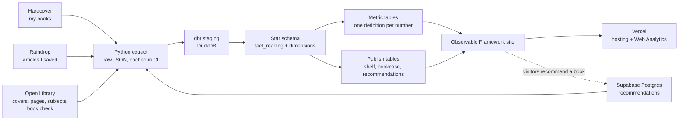

# The Reading Room

Everything I read, books and articles, on a lit 3D bookcase, with a small dbt warehouse underneath. Visitors can recommend me books. The site rebuilds itself every night on GitHub Actions and is hosted free on Vercel.

**Live site:** https://reading-library-psi.vercel.app/
**dbt docs (models, lineage, tests):** https://reading-library-psi.vercel.app/docs/
**Case study:** [docs/case-study.md](docs/case-study.md)

## How it works



Every night at 03:00 UTC one workflow ([`nightly.yml`](.github/workflows/nightly.yml)) runs:

1. **Lint and test**: ruff, pytest.
2. **Extract** (`python -m extract`): books from the Hardcover GraphQL API, articles from Raindrop, recommendations from Supabase, each book matched on Open Library. Raw answers are written to `data/raw/`, which is never committed: the last extract that passed every test is kept in the GitHub Actions cache instead. An empty or failed Hardcover answer stops the run, so a bad night cannot wipe the library. Raindrop and Supabase are optional: if either is down, the books still update and the cached articles and recommendations stay.
3. **dbt build**: models and tests on DuckDB, then source freshness and dbt docs.
4. **Site build**: node tests, then Observable Framework turns the published tables into static pages.
5. **Deploy** the finished static site to Vercel (hosting and Web Analytics), only if every step above passed. Otherwise yesterday's site stays up. Vercel builds nothing; Actions does all the work.

Pull requests run [`ci.yml`](.github/workflows/ci.yml) without secrets or data: ruff, pytest, the site tests and `dbt parse`. The full build with data runs in the nightly job.

## Sources

| Source | What it gives | How |
|---|---|---|
| Hardcover | my books, shelf status, ratings, finish dates | GraphQL API, `HARDCOVER_API_TOKEN` |
| Open Library | covers, page counts, subjects, descriptions; checks that a recommended book is real | public API |
| Raindrop | articles: every bookmark is one I finished (saved from the Substack or Medium share button) | REST API, `RAINDROP_TOKEN` |
| Supabase | books visitors recommend | Postgres REST, anon key on the site, service key in CI |

## Data model

dbt project in [`dbt/`](dbt/), on a single DuckDB file. Layers: `staging` → `marts` (star schema) → `metrics` and `publish`. The site reads only the `metrics` and `publish` schemas.

**Fact grain: one row per finished read of one item.** A re-read is two rows. A book I want to read is not a row. An article is read once, on the day it was saved.

- `fact_reading`: reading_id, item_id, date_id (nullable), rating (0 to 10), reading_minutes
- `dim_item`: books and articles together, told apart by `item_type`
- `dim_creator` + `bridge_item_creator`, `dim_topic` + `bridge_item_topic`, `bridge_item_mood`, `dim_source`, `dim_date`

**Metrics**, one dbt model each: items read, books and reads per period, pages, reading time, reading pace and reading spells, average rating (by type, genre, topic, creator), rating spread, top authors, genre mix, fiction split, moods, page-length bands, publication years, article sources, topic mix, undated reads.

**Reading pace** is measured inside reading spells: a gap of more than 180 days between books (`reading_break_days` in `dbt_project.yml`) ends a spell, so long breaks do not drag the average down.

**Recommendations** are kept out of the reading model. Visitors can only insert rows (row-level security, [`supabase/recommendations.sql`](supabase/recommendations.sql)). The extract keeps only books that check out as real Open Library works, using Open Library's title, author and cover; a name or note containing a link is dropped. dbt folds repeat recommendations into one row per book.

## Tests

- 54 dbt data tests (keys, accepted values, relationships) across 45 models, and 16 dbt unit tests for the edge cases: re-reads, undated reads, abandoned books, unmatched books, articles entering the model, repeat recommendations, shelf order, reading-spell boundaries.
- **Consistency test**: dated plus undated reads equal total reads, and totals agree across metrics.
- **Privacy test**: every column in the published schemas must be on an allow-list ([`dbt/seeds/allowed_published_columns.csv`](dbt/seeds/allowed_published_columns.csv)).
- pytest for the extractors (API calls mocked), node tests for the site's helpers.

## The site

Built with [Observable Framework](https://observablehq.com/framework/), three.js, Observable Plot and [Motion](https://motion.dev/). Two pages: the library and Stats.

**The bookcase (home page)**
- A three.js scene: each book is a solid block with its spine printed from its own cover colour and art, sized by page count. Articles stand as slim journals with their Substack preview image.
- Lit like a modern bookcase: an LED strip hidden under the top board washes warm light down the wall. The vase and the plant are photo-scanned [Poly Haven](https://polyhaven.com) models (CC0), packed with [`scripts/pack_glb.py`](scripts/pack_glb.py).
- Glide along by dragging, scrolling the mouse wheel, the scroller or the arrow keys. Pointing at a book lifts it; clicking slides it out and turns its cover to you.
- On first view the camera walks up to the shelf and a ripple runs along the books.
- Taking a book off the shelf flies it out into a full-size 3D book viewer (cover, spine, page block) with a little gold dust where it lands. Previous and next turn the book; closing flies it back.
- "Recommended to me" stands in a second compartment of the same bookcase. Search looks through every compartment; genre buttons narrow my shelf.
- "Worth reading": my five-star picks on a 3D coverflow.
- A tape deck in the corner plays café sounds (coffee, rain, piano, a quiet room), generated live with the Web Audio API, so there are no audio files. Sound starts only on Play.

**Stats**
- Headline figures that count up as they come into view, then charts in Observable Plot: reading pace, books by year, articles, fiction and non-fiction, genres, moods, ratings, length, authors I return to, ratings by genre, publication years and a reading calendar. Each chart has its numbers in a table underneath.

**Everywhere**
- Dark green, rust orange and burgundy, with a light mode that turns the 3D room into a daylit one. It follows the system setting; the toggle in the nav overrides it.
- Reduced-motion preferences are respected: the camera walk, ripples and flights are skipped.
- Works without WebGL (a CSS shelf takes over) and down to phone width.

## Run it locally

Requirements: Python 3.12, Node 20.

```bash
python -m venv .venv
.venv/Scripts/pip install -r requirements-dev.txt      # macOS/Linux: .venv/bin/pip
cp .env.example .env                                     # then fill in the tokens

.venv/Scripts/python -m extract                         # needs HARDCOVER_API_TOKEN
cd dbt && ../.venv/Scripts/dbt build --profiles-dir . && cd ..

cd site
npm ci
PYTHON=../.venv/Scripts/python npx observable preview   # http://127.0.0.1:3000
```

Tests: `ruff check .`, `pytest -q`, `cd site && npm test`.

## Deploying your own copy

1. Repository secrets: `HARDCOVER_API_TOKEN`, `RAINDROP_TOKEN` (optional), `SUPABASE_SERVICE_KEY` (optional).
2. Repository variables: `SUPABASE_URL`, `SUPABASE_ANON_KEY` (optional; without them the recommend form is hidden).
3. A Vercel project (`npx vercel link`), with `VERCEL_TOKEN` as a repository secret and `VERCEL_ORG_ID`, `VERCEL_PROJECT_ID` as repository variables. Turn on Web Analytics in the Vercel project.
4. Run the nightly workflow once from the Actions tab.

For recommendations, create a free Supabase project and run [`supabase/recommendations.sql`](supabase/recommendations.sql) in its SQL editor.

## Layout

```
extract/            Python extractors (Hardcover, Open Library, Raindrop, Supabase)
data/raw/           raw extracts (local and CI cache only, not in git)
dbt/                models, seeds, tests
site/src/           Observable Framework pages, components, data loaders, 3D models
supabase/           the recommendations table and its access rules
scripts/            dbt docs copy, glTF packer
tests/              pytest for the extractors
docs/case-study.md  the write-up
```

## Credits

Book data from Hardcover and Open Library. Shelf objects from Poly Haven (CC0).
