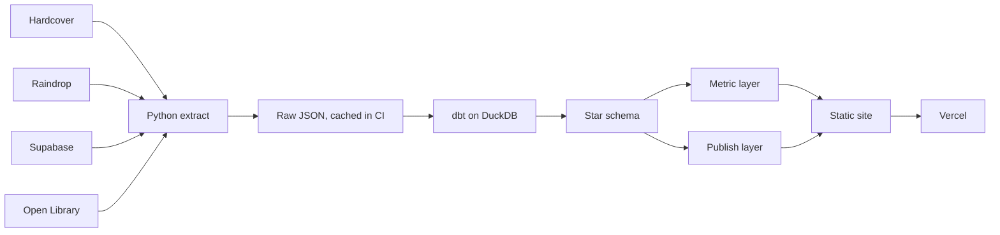

# Case study: Reading Library

A personal reading data pipeline: books, articles and visitor recommendations from four sources, modelled in dbt on DuckDB, tested, and published nightly as a static site.

Live since November 2026: https://reading-room-shelf.vercel.app · Code: https://github.com/surbhi-bhor/reading-library

## Why

I track my books on Hardcover, which has great stats of its own, and save the articles I read in Raindrop. I wanted everything I read together in one place, and more control over my stats: every number defined once, tested, refreshed without manual work, and safe to publish.

## Approach

### Pipeline

One GitHub Actions workflow runs nightly and on every push: lint and tests, extract, `dbt build` (models and tests), site build, deploy. If any test fails, nothing deploys and the live site keeps the previous day's data.

### Data model

The fact table's grain is **one row per finished read of one item**: a re-read is two rows, a want-to-read book is no row, an article counts once on the day it was saved. Books and articles share `dim_item`, split by `item_type`, so one fact table answers "everything I read" while book-only metrics filter on type. Authors, Open Library subjects and reader moods hang off bridge tables. Recommendations stay out of the reading model entirely, since they are books I have not read.

Genres are assigned by rules over Open Library subjects, Hardcover tags and the title, then the author's usual genre, then Fiction, kept in a seed file rather than hand-tagged.

### Metric layer

Each metric is one dbt model (19 in total), and the site reads only the metric and publish schemas, so a number shown in two places comes from the same table.

Reading pace needed more care. The plain average, first to last dated book, gives one book every 105 days, which hides that I read in spells with long gaps between. A spell ends after a gap of more than 180 days (a single dbt variable), and pace is measured inside spells: one book every 39 days while reading.

### Recommendations: app database to warehouse

Visitors send a book through a form on the site. The page writes straight to a Supabase Postgres table with the public key; row-level security makes the table insert-only. The nightly extract reads it with the service key, keeps only books that resolve to a real Open Library work, and uses Open Library's title, author and cover instead of what the visitor typed. Names or notes containing a link are dropped. dbt then folds repeat recommendations into one row per book. This is the operational-database-to-warehouse pattern at small scale.

### Data quality

- 54 data tests across 45 models: keys, accepted values, relationships.
- 16 unit tests for the edge cases: re-reads, undated reads, abandoned and unmatched books, articles, repeat recommendations, shelf order, reading-spell boundaries.
- A consistency test that dated plus undated reads equal total reads, and that totals agree across metrics.
- A privacy test: every published column must be on an allow-list.
- Source freshness warnings, and extractors that never let an empty or failed Hardcover response replace good data.

## Decisions and trade-offs

| Decision | Why | Trade-off |
|---|---|---|
| DuckDB + dbt, no hosted warehouse | Free, a single file, runs inside CI | Not a big-data stack; the data is small |
| Raw extracts kept out of the repo, last good one in the Actions cache | No personal or visitor data in git history; a failed API call still cannot wipe the site | Pull requests cannot build with data, so they run lint, unit tests and `dbt parse` only |
| Articles in the same star schema as books | One fact table for everything read | Articles have no pages or rating, so several metrics stay books only |
| Articles kept out of time-based charts | They are dated by save day; a week of saving would look like a record month | Article counts get their own tile and chart |
| Pace measured inside reading spells | The lifetime average made long breaks look like slow reading | The 180-day break is a judgement call, kept in one variable |
| Supabase for recommendations | Shows the app-to-warehouse pattern; visitors need no account | One more service, and free projects pause after a week idle |
| No manual approval, Open Library verification instead | Spam can only add a real book; repeats fold into one | A rude name or note shows until I delete the row |
| Static site with build-time data | Nothing to run or attack, cheap to host | Data is at most a day old |

## Results

- **Live:** https://reading-room-shelf.vercel.app, with dbt docs at `/docs`.
- **Data:** 38 books and 6 articles on the shelves, all finished reads; 34 books have a finish date and 4 do not (counted in totals, not in any month).
- **Warehouse:** 45 dbt models (6 staging, 11 marts, 19 metrics, 5 publish), 54 data tests, 16 unit tests, plus pytest for the extractors.
- **Nightly run:** about 1 to 2 minutes end to end, from extract to deploy.
- **Cost:** nothing. GitHub Actions, Vercel Hobby and the Supabase free tier.
- **Lighthouse (home page):** mobile 27 performance, 90 accessibility, 100 best practices, 100 SEO; desktop 40, 90, 100, 100. Performance is the weak spot: the 3D shelf, about 44 cover images and the 3D models load up front (largest contentful paint 18.6 s on mobile, 5.6 s on desktop).

## What I learned

- **Decide the grain first.** Re-reads, undated reads and abandoned books only stopped causing disagreements once the fact table had one clear grain and the edge cases had unit tests.
- **An average can be true and misleading.** The lifetime reading pace was correct but described my breaks, not my reading. Measuring inside spells answered the real question.
- **Dates mean different things in different sources.** An article's date is when I saved it, so it does not belong on the same timeline as a book's finish date.
- **Visitor data needs a different safety rule.** For books, an empty API answer is treated as a failure and never overwrites history. For recommendations, an empty answer can be real (I deleted a row), so it must be written as empty. And visitor names should never be in git history, which cannot be rewritten for one person.
- **Run CI's exact commands locally.** The first CI run failed because I had been running `python -m pytest`, which hides an import-path problem that plain `pytest` exposes.
- **Front-end weight is a real cost.** The 3D shelf is what makes the site memorable, and also what drags its performance score down.

## Next

- Load the 3D shelf and covers lazily to bring mobile performance up.
- A custom domain.
- Swap any test recommendations for real ones as they arrive.
