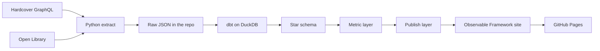

# Case study: The Reading Library

A public website of everything I have read, built like a real library, with a small but properly modelled BI stack underneath.

Status: in design, November 2026. Sections marked "to fill" get real numbers once the site is live.

## Summary

I turned my reading history into a static website that looks and feels like walking into a library: books stand on wooden shelves as spines, and you pull one out to see the cover, my rating and when I finished it. Under the shelves sits a DuckDB warehouse modelled with dbt as a star schema, with every number on the site defined once in a metric layer. A nightly GitHub Actions job pulls my books from Hardcover, enriches them from Open Library, tests the data and redeploys the site to GitHub Pages. It costs nothing to run and needs no laptop.

## Problem statement

My reading lives in Hardcover, a reading tracker. It is good at logging books, but it does not give me what I actually want:

1. **A place to enjoy my reading history.** Tracker apps show lists and progress bars. I wanted something I would browse for pleasure and share with friends, closer to standing in front of my own bookshelf.
2. **Numbers I can trust.** Questions like "how many books did I read this year" or "which topics do I read most" have messy answers. About half my books have no finish date, some books are re-reads, some I abandoned. A quick chart either hides those cases or counts them wrong, and two charts built separately can disagree with each other.
3. **A public BI portfolio piece.** My main data project (a personal content pipeline) runs locally with private data, so I cannot host it. I needed something live and public that shows warehouse modelling, a metric layer, data quality and automated delivery end to end, without exposing anything private.

So the problem is: **how do I turn a small, sparse, messy personal dataset into a public site that feels like a library, where every number is correct and consistent, that refreshes itself for free?**

## Who it is for

1. Me: a personal library I enjoy and that keeps itself up to date.
2. Friends: a link I can share.
3. Recruiters and hiring managers: proof that I can model data, define metrics, test data and ship it on a schedule.

## Goals and success criteria

| Goal | How I will know |
|---|---|
| Feels like a library, not a dashboard | People describe it as a bookshelf or library when they first open it; no chart widgets on the main page |
| One definition per number | A dbt test fails the build if any two published totals disagree |
| Honest with sparse data | Undated reads have their own shelf and count; nothing is silently dropped |
| Hands-off | Logging a book in Hardcover is the only manual step; the nightly job does the rest |
| Free | No paid services; GitHub Actions and Pages only |
| Nothing private leaks | A dbt test checks every published column against an allow-list |

## Constraints

- **Small, sparse data.** About 30 books, roughly half with a finish date. Every view must still look good.
- **Zero budget.** Public GitHub repo, Actions and Pages. No database server, no paid APIs.
- **Static only.** No login and no backend, so the safety boundary is "what gets published", not access control.
- **Secrets stay in CI.** The Hardcover token lives in GitHub Actions secrets and never reaches the built site.

## Approach

### Architecture

Everything runs in one nightly GitHub Actions workflow: extract, `dbt build` (models and tests), site build, deploy. If any dbt test fails, the deploy step never runs, so the live site keeps yesterday's good data.

### Data model

Grain of the main fact: **one row per finished read of one item**. A re-read is two rows; a book I want to read is not a row at all.

- `fact_reading`: reading_id, item_id, date_id (nullable finish date), rating (0 to 10), reading_minutes (estimated from page count)
- `dim_item`: title, cover, page count, first published year, current shelf status
- `dim_creator` with `bridge_item_creator` for multi-author books
- `dim_topic` with `bridge_item_topic`, with generic catalogue tags ("Fiction", "New York Times bestseller", shelf categories) flagged and ignored
- `dim_source` (publisher) and `dim_date`

The model is built to take articles later (item type, word count, source domain) without changing the fact's grain.

### Metric layer

Each metric is one dbt model, documented once, and the site reads only these tables:

items read, books per year and month, pages read, reading time, average rating (by type, topic and creator), top creators, topic mix, long-form share, undated reads.

### Data quality and trust

- Unique and not-null keys, relationships between the fact and every dimension, ratings between 0 and 10, accepted item types.
- dbt unit tests for the tricky cases: re-reads, undated reads, books moved back to want-to-read, abandoned books, books Open Library cannot match.
- A consistency test: dated plus undated reads must equal total reads, and every total must match the fact table.
- A privacy test: every column in the published schemas must be on an allow-list.
- Source freshness on the raw extracts, shown on the site as "last updated".
- Extractors never overwrite good data with an empty API response; the run fails loudly instead.

### Design

The visual starting point was a minimal online bookshelf with spines painted from cover art. I made it warmer and more classic: wooden shelves with grain and shadow, parchment and walnut tones, an old-style serif for headings and small brass details. Data is shown in library form rather than charts:

- **Shelves**: the main shelf, a want-to-read shelf, a shelf per year, a 5-star shelf and an honest "Undated" shelf.
- **Card catalogue**: one drawer per topic, drawer height showing the topic mix.
- **Checkout card**: ink stamps per month as the reading timeline.
- **Ledger and author cards** for totals and top authors.
- **How this is made**: last updated, pipeline diagram, links to the dbt lineage docs and the code.

## Key decisions and trade-offs

| Decision | Why | Trade-off |
|---|---|---|
| DuckDB + dbt instead of a hosted warehouse | Free, fast, a single file, runs inside CI | Not a "big data" stack, but right-sized for the data |
| Raw extracts committed to the repo | A failed API call can never wipe history; CI on pull requests can build without secrets | Nightly data commits in the git history |
| Metrics as plain dbt models | Light in CI and easy to read; the rule that matters is one definition per number | No semantic-layer query API |
| Static site with build-time data | Free hosting, nothing to attack, fast | Data is at most a day old |
| Separate from my main project | This one is public, so nothing private can leak by design | Some logic is copied rather than shared |
| Show want-to-read and currently reading | Makes it feel like a real, living library | Must keep them out of every metric, enforced by tests |

## Risks and how I handle them

| Risk | Mitigation |
|---|---|
| Hardcover API changes or returns an error with HTTP 200 | Extractor checks for GraphQL errors and fails the run; raw file left untouched |
| Open Library cannot match a book | The book still appears with a cloth-colour spine; it is retried every night |
| Charts look empty with sparse data | Library metaphors that work with few items; undated reads shown, not hidden |
| A private field slips into the site | Allow-list test on every published column |
| Numbers disagree between pages | Every page reads the same metric tables; a consistency test guards totals |

## Delivery plan

1. Repo, CI and the Hardcover extractor
2. dbt staging and star schema with tests, published dbt docs
3. Metric and publish layers
4. The library UI on real data
5. Nightly workflow and GitHub Pages: site live with books
6. Articles (logging tool to be chosen)
7. Polish: year in review, "how this is made", README

## Results (to fill)

- Live site: to fill
- Books on the shelves, finished reads, undated share: to fill
- dbt models and tests: to fill
- Nightly run time: to fill
- Lighthouse scores for the library page: to fill

## What I learned (to fill)

To fill after launch.
