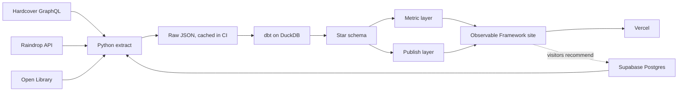

# Case study: Reading Library

A public website of everything I read, books and articles, laid out like a bookcase, on top of a small data warehouse modelled with dbt. Visitors can also recommend books to me. The site itself is called The Reading Room.

Status: live since November 2026 at https://reading-room-shelf.vercel.app. Sections marked "to fill" get real numbers once the site is live.

## Summary

I turned my reading history into a static website laid out as a bookcase. Books and saved articles stand on a lit 3D shelf as spines printed from their covers; you pull one out to see the cover, my rating and when I finished it. A second compartment of the same bookcase holds books visitors have recommended to me.

Under the shelves sits a DuckDB warehouse modelled with dbt as a star schema, with every number on the site defined once in a metric layer. A nightly GitHub Actions job pulls my books from Hardcover, my articles from Raindrop and visitors' recommendations from a Supabase Postgres table, enriches and verifies them against Open Library, tests everything and redeploys the site to Vercel. It costs nothing to run and needs no laptop.

## Problem statement

My reading lives in Hardcover, a reading tracker. It logs books well, but it does not give me these:

1. **A place to enjoy my reading history.** Tracker apps show lists and progress bars. I wanted something I would browse for pleasure and share with friends, closer to standing in front of my own bookshelf.
2. **Numbers I can trust.** Questions like "how many books did I read this year" have messy answers. Some books have no finish date, some are re-reads, some I abandoned, and articles are dated by when I saved them. A quick chart either hides those cases or counts them wrong, and two charts built separately can disagree.
3. **Everything I read in one place.** Books are in Hardcover, but the essays I read on Substack and Medium were nowhere.
4. **A public BI portfolio piece.** My main data project runs locally with private data, so I cannot host it. I needed something live and public that shows source integration, warehouse modelling, a metric layer, data quality and automated delivery end to end, without exposing anything private.

The problem: **turn a small, sparse, messy personal dataset from several sources into a public site shaped like a bookcase, where every number is correct and consistent, and that refreshes itself for free.**

## Who it is for

1. Me: a personal library I enjoy and that keeps itself up to date.
2. Friends and visitors: a link to share, and a way to recommend me a book.
3. Recruiters and hiring managers: a working example of integrating sources, modelling data, defining metrics, testing data and shipping it on a schedule.

## Goals and success criteria

| Goal | How I will know |
|---|---|
| A bookcase, not a dashboard | The home page is a bookcase; charts live on their own Stats page |
| One definition per number | A dbt test fails the build if any two published totals disagree |
| Honest with sparse data | Undated reads count in the totals and are named as undated; nothing is silently dropped |
| Hands-off | Marking a book finished in Hardcover or saving an article to Raindrop is the only manual step |
| Free | GitHub Actions, Vercel's Hobby plan and Supabase's free tier |
| Nothing private leaks | A dbt test checks every published column against an allow-list |

## Constraints

- **Small, sparse data.** About 37 books and a handful of articles; some books have no finish date. Every view must still look good.
- **Zero budget.** Public GitHub repo and Actions, Vercel Hobby, Supabase free tier. No paid APIs.
- **Static site.** No login and no server of my own, so the safety boundary is "what gets published", not access control.
- **Secrets stay in CI.** API tokens and the Supabase service key live in GitHub Actions secrets and never reach the built site.

## Approach

### Architecture

Everything runs in one nightly GitHub Actions workflow: extract, `dbt build` (models and tests), Python and site tests, site build, deploy. If any test fails, the deploy step never runs, so the live site keeps yesterday's good data.

### Sources

- **Hardcover** (GraphQL): my books, shelf status, ratings and finish dates.
- **Open Library**: covers, page counts, subjects, descriptions; also the check that a recommended book is real.
- **Raindrop**: every bookmark is an article I finished, saved from the Substack or Medium share button; its first tag is the topic, its preview image the cover.
- **Supabase** (Postgres): the table visitors write recommendations to.

Books are required; the other sources are optional, so a Raindrop or Supabase outage never stops the books from updating.

### Data model

Grain of the main fact: **one row per finished read of one item**. A re-read is two rows; a book I want to read is not a row at all; an article is read once, on the day it was saved.

- `fact_reading`: reading_id, item_id, date_id (nullable), rating (0 to 10), reading_minutes (estimated from page count)
- `dim_item`: books and articles in one dimension, told apart by `item_type`, with title, cover, page count, genre and shelf status
- `dim_creator` with `bridge_item_creator` for multi-author books
- `dim_topic` with `bridge_item_topic`, with generic catalogue tags flagged and ignored
- `bridge_item_mood` for the moods other readers give a book
- `dim_source` (publishers of books, publications of articles) and `dim_date`

Recommendations stay out of the reading model: they are books I have not read, so they must never reach a reading metric.

### Recommendations: an app database feeding the warehouse

Visitors search Open Library on the site, pick a book, optionally add their name and a note, and the page inserts a row into Supabase with the public anon key. Row-level security makes the table insert-only for visitors: they cannot read, change, delete or pre-approve anything.

Each night the extract reads the table with the service key and keeps only books that check out as real Open Library works, using Open Library's own title, author and cover rather than anything the visitor typed. Names or notes containing a web link are dropped, since that is what spam bots post. Checked books are cached in the raw file, so each is looked up once. dbt folds repeat recommendations of the same book into one row, and the home page shows them in a lower compartment of the bookcase.

This is the usual operational-database-to-warehouse pattern at small scale: the app writes to Postgres, and a nightly batch job copies, validates and models the rows for reporting.

### Metric layer

Each metric is one dbt model, documented once, and the site reads only the metric and publish schemas: items read, books and reads per period, pages read, reading time, reading pace and reading spells, average rating (by type, genre, topic, creator), rating spread, top creators, genre mix, fiction split, mood mix, page-length bands, publication years, article sources, topic mix, long-form share and undated reads.

### Reading pace: measured inside reading spells

A plain average, the days between my first and last dated book divided by the books, came out at one book every 105 days. That is true but misleading: my history has long gaps (study, slumps) when I read nothing, and they drag the average down.

So pace is measured inside **reading spells**. A spell is a run of finished books where no two finish dates are more than 180 days apart (a dbt variable, `reading_break_days`, so the threshold is a single documented choice). A longer gap ends one spell and the next book starts a new one. Two books finished on the same day always land in the same spell.

- `metric_reading_spells`: one row per spell, with start, end, books, days per book and books per year, and whether it is still running (last book within 180 days of today). One-book spells have no gap to measure, so they carry no pace.
- `metric_reading_pace`: one row that keeps the lifetime figures for context, and adds the pace inside spells, the current spell and the books finished in the last 12 months.

On today's data that gives four spells, and a pace of one book every 39 days while reading, against 105 over the whole span. The Stats page leads with the current spell and the last 12 months, and states the lifetime figure underneath, breaks included. A consistency test checks that the books across all spells add up to the dated reads, and a unit test pins the edges: a gap of exactly 180 days stays in one spell, 181 starts a new one, books on the same day share a spell, and an article in a gap does not bridge it.

### Data quality and trust

- Unique and not-null keys, accepted values, and relationships between the fact and its dimensions: 54 data tests across 45 models.
- 16 dbt unit tests for the tricky cases: re-reads, undated reads, books moved back to want-to-read, abandoned books, unmatched books, articles entering the model, repeat recommendations, shelf order, reading spell boundaries.
- A consistency test: dated plus undated reads must equal total reads for books and for everything, and article totals must match across metrics.
- A privacy test: every column in the published schemas must be on an allow-list.
- Source freshness on the raw extracts (warns when an extract is more than 36 hours old).
- Extractors never overwrite good book data with an empty API response; the run fails loudly instead. For recommendations, a successful empty answer is written as empty (deleting a row must take it off the site), while a failed fetch keeps yesterday's file.
- Python (pytest) and site (node) tests run in CI before deploy.

### Design

The visual starting point was a minimal online bookshelf with spines painted from cover art. I made it warmer and more classic: a dark green and walnut room with rust orange and burgundy accents, a classical serif for headings, and a light mode that turns the room into a daylit one.

- **Home**: one bookcase. The top compartment is everything I have read, books and articles together, newest first, on a lit three.js shelf with spines printed from each cover. You scroll or drag along it and pull a book out to see it full size. Search covers the whole bookcase; genre buttons narrow my shelf. Below it, "Recommended to me" stands in a second compartment, then the five-star picks.
- **Stats**: totals, reading pace, books by year, genres, moods, ratings, length, publication years, article sources, authors I return to and a reading calendar, all from the metric tables. Earlier Catalogue and Year in review pages repeated these numbers, so they were removed.
- **The engineering lives on GitHub**: the site itself stays for readers. The repository README, the dbt docs (published with the site at `/docs/`) and this case study carry the pipeline story; the footer links to the repository.
- **Real objects, not drawings**: the vase and plant on the shelf are photo-scanned Poly Haven models (CC0), and the shelf is lit like a modern bookcase, by an LED strip hidden under the top board.

## Decisions and trade-offs

| Decision | Why | Trade-off |
|---|---|---|
| DuckDB + dbt instead of a hosted warehouse | Free, fast, a single file, runs inside CI | Not a "big data" stack; the data is small |
| Raw extracts kept out of the repo, last good one in the Actions cache | No personal or visitor data in git history; a failed API call still cannot wipe the site | Pull requests cannot build with data, so they run lint, unit tests and `dbt parse` only |
| Articles as items in the same star schema | One fact table answers "everything I read"; book-only metrics filter on item type | Articles have no pages or rating, so several metrics stay books only |
| Articles kept out of the timelines on Stats | Each article is dated the day it was saved, so a week of saving would look like a record month | Article counts live in their own tile and card |
| Supabase for recommendations | Shows the app database to warehouse pattern; visitors need no account | One more service, and it pauses after a week of inactivity on the free tier |
| No manual approval, Open Library verification instead | Spam can only ever add a real book, and repeats fold into one | A rude name or note shows until I delete the row; links are filtered out |
| Pace measured inside reading spells, not over the whole history | Long breaks would otherwise make me look like a much slower reader than I am | The 180-day break is a judgement call; it is one variable, so it is easy to change and see the effect |
| Static site with build-time data | Free hosting, nothing to attack, fast | Data and recommendations are at most a day old |
| Separate from my main project | This one is public and holds no private data | Some logic is copied rather than shared |

## Risks and how I handle them

| Risk | Mitigation |
|---|---|
| Hardcover API changes or returns an error with HTTP 200 | Extractor checks for GraphQL errors and fails the run; raw file left untouched |
| Open Library cannot match a book | It still appears with a cloth-colour spine and is retried every night |
| Raindrop or Supabase is down | The run carries on with books; yesterday's articles and recommendations stay |
| Spam recommendations | Insert-only access, real Open Library books only, links dropped from names and notes, one row per book |
| A private field slips into the site | Allow-list test on every published column |
| Numbers disagree between pages | Every page reads the same metric tables; a consistency test guards totals |

## Delivery

1. Repo, CI and the Hardcover extractor (done)
2. dbt staging and star schema with tests, dbt docs (done)
3. Metric and publish layers (done)
4. The library UI on real data, then the 3D bookcase (done)
5. Articles from Raindrop in the same model (done)
6. Recommendations through Supabase (done)
7. Nightly workflow, site live on Vercel with Web Analytics (done)
8. README and results

## Results (to fill)

- Live site: to fill
- Books and articles on the shelves, finished reads, undated share: to fill
- Recommendations received: to fill
- Nightly run time: to fill
- Lighthouse scores for the library page: to fill

## What I learned (to fill)

To fill after launch.
