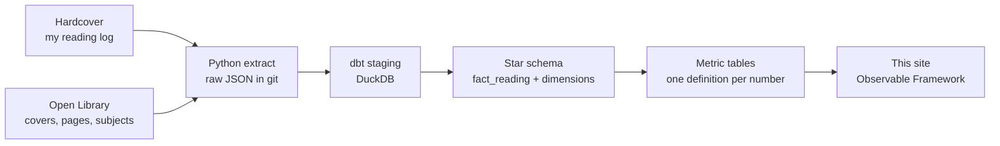

```js
import {REPO_URL} from "./components/site.js";
const build = await FileAttachment("data/build.json").json();
const when = (iso) => new Date(iso).toLocaleString("en-GB", {day: "numeric", month: "long", year: "numeric", hour: "2-digit", minute: "2-digit", timeZone: "UTC", timeZoneName: "short"});
```

<header class="page-head">
  <h1>How this is made</h1>
  <p>The library is a small data warehouse with a reading room on top. All I do is mark a book finished in my Hardcover reading app; everything after that runs on its own every night.</p>
</header>

```js
display(html`<dl class="tiles">
  <div><dt>Shelves last rebuilt</dt><dd class="tile-text">${when(build.built_at)}</dd></div>
  <div><dt>Hardcover last read</dt><dd class="tile-text">${when(build.hardcover_extracted_at)}</dd></div>
  <div><dt>Books on the shelves</dt><dd>${build.items_on_shelves}</dd></div>
</dl>`);
```

## From reading log to shelf



<div class="about-notes">

**Every night**, a GitHub Actions job reads my books from the Hardcover API and matches each one on Open Library for its cover, page count and subjects. The raw answers are saved in the repository, and an empty answer never replaces a good one, so a bad night can't wipe the library.

**dbt builds the warehouse** in a single DuckDB file. One row in `fact_reading` is one finished read: a book I read twice has two rows, and a book I want to read has none. Around it sit dimensions for books, authors, publishers, genres, topics and dates.

**Every number is defined once.** Each figure on these pages comes from one metric table, and a test fails the build if two of them disagree. If any test fails, nothing is published and yesterday's library stays up.

**Nothing private leaves.** A test checks every column the site can read against an allow-list.

</div>

## What each number means

<div class="definitions">

**Books finished**: finished reads. A re-read counts again.

**Pages turned**: page counts of finished books, where Open Library knows them.

**Hours of reading**: an estimate, at 40 pages an hour.

**Average rating**: the mean of my star ratings over rated books.

**Genre**: one shelf per book, matched automatically from Open Library subjects, Hardcover genre tags and the title.

**Without a finish date**: books I read before I kept dates. They are on the shelves and in the totals, but not in any month or year.

</div>

```js
display(html`<p class="about-links">
  <a href="./docs/">Model and lineage (dbt docs)</a>
  ${REPO_URL ? html`<a href=${REPO_URL}>Source code on GitHub</a>` : ""}
  <a href="./stats">The numbers as charts</a>
</p>`);
```
